# Defense in Depth for a Web Application

**Cryptography and Network Security Lab**

A hands-on lab that protects a small web application with several independent security layers, so that no single control is a single point of failure. An Ubuntu VM is the protected server, a Kali Linux VM generates controlled test traffic, and each layer is verified with packet counters, logs, alerts and HTTP responses.

> All testing is done in an isolated, private lab network. Do not run any of these tests against systems you do not own or have written permission to test.

---

## Table of Contents

1. [Project summary](#1-project-summary)
2. [Project status](#2-project-status)
3. [System architecture](#3-system-architecture)
4. [Security layers and request flow](#4-security-layers-and-request-flow)
5. [Lab environment](#5-lab-environment)
6. [End-to-end procedure](#6-end-to-end-procedure)
   - [Phase 1: Network setup](#phase-1-network-setup-done)
   - [Phase 2: iptables firewall](#phase-2-iptables-firewall-done)
   - [Phase 3: Nginx web server](#phase-3-nginx-web-server-done)
   - [Phase 4: Snort installation and validation](#phase-4-snort-installation-and-validation-done)
   - [Phase 5: Snort IDS rules and alerts](#phase-5-snort-ids-rules-and-alerts-pending)
   - [Phase 6: Flask application and Nginx reverse proxy](#phase-6-flask-application-and-nginx-reverse-proxy-pending)
   - [Phase 7: Snort inline IPS (NFQUEUE)](#phase-7-snort-inline-ips-nfqueue-pending)
   - [Phase 8: JWT authentication](#phase-8-jwt-authentication-pending)
   - [Phase 9: OAuth 2.0 Authorization Code flow](#phase-9-oauth-20-authorization-code-flow-pending)
   - [Phase 10: Final verification](#phase-10-final-verification-pending)
7. [How to read the evidence](#7-how-to-read-the-evidence)
8. [Screenshot index](#8-screenshot-index)
9. [Security notes for this repository](#9-security-notes-for-this-repository)
10. [Troubleshooting](#10-troubleshooting)
11. [Conclusion](#11-conclusion)

---

## 1. Project summary

| Item | Description |
|---|---|
| Goal | Show that layered security (network filtering, detection, prevention, authentication, authorization) protects a web application better than any single control |
| Protected server | Ubuntu VM running iptables, Snort, Nginx and Flask |
| Test machine | Kali Linux VM that generates allowed, blocked and malicious-looking test requests |
| Network | Private host-only network `192.168.56.0/24` |
| Verification | iptables packet and byte counters, kernel logs, Snort alerts, Nginx access logs, HTTP status codes |

In one sentence: Ubuntu is the protected web server, Kali generates controlled test traffic, and multiple security layers filter, detect, prevent, authenticate and authorize requests.

---

## 2. Project status

- [x] Phase 1: Network setup (host-only IPs, connectivity)
- [x] Phase 2: iptables firewall (default DROP, explicit allows, logging)
- [x] Phase 3: Nginx installed and running; legitimate HTTP request tested
- [x] Phase 4: Snort installed; configuration validated
- [ ] Phase 5: Snort IDS custom rules, ICMP and TCP SYN alerts
- [ ] Phase 6: Flask application and Nginx reverse proxy
- [ ] Phase 7: Snort inline IPS with NFQUEUE (SQL-injection-like request dropped)
- [ ] Phase 8: JWT authentication (missing, valid and tampered token)
- [ ] Phase 9: OAuth 2.0 Authorization Code flow
- [ ] Phase 10: Final verification and summary

Phases marked **(done)** include the screenshots already captured. Phases marked **(pending)** contain the full procedure and the screenshot names to capture.

---

## 3. System architecture

```
+----------------------------------------------------------------------------+
|                         PHYSICAL HOST (Windows)                            |
|                       Hypervisor + Host-only adapter                       |
|                                                                            |
|   +----------------------------------------------------------------------+ |
|   |             Host-only Network  --  192.168.56.0/24                    | |
|   |                                                                      | |
|   |   +-------------------------------+   +---------------------------+  | |
|   |   |        UBUNTU VM              |   |         KALI VM           |  | |
|   |   |    (protected server)         |   |    (testing machine)      |  | |
|   |   |    192.168.56.101             |   |    192.168.56.102         |  | |
|   |   |-------------------------------|   |---------------------------|  | |
|   |   |  iptables  (firewall)         |   |  HTTP requests (curl)     |  | |
|   |   |  Snort     (IDS / inline IPS) |<--|  Connectivity tests       |  | |
|   |   |  Nginx     :80 (reverse proxy)|   |  Controlled test traffic  |  | |
|   |   |  Flask     :5000 (localhost)  |   |                           |  | |
|   |   +-------------------------------+   +---------------------------+  | |
|   +----------------------------------------------------------------------+ |
|                                                                            |
|   NAT adapters provide separate internet access when required.             |
+----------------------------------------------------------------------------+
```

---

## 4. Security layers and request flow

| Layer | Component | Role |
|---|---|---|
| 1. Network filtering | iptables | Default DROP; allows only required traffic; logs dropped packets |
| 2. Detection | Snort IDS (passive) | Matches selected traffic patterns and raises alerts |
| 3. Prevention | Snort inline IPS (NFQUEUE) | Drops a matching request before it reaches the web server |
| 4. Web server | Nginx | Public-facing reverse proxy on port 80 |
| 5. Application | Flask | Application routes, bound to `127.0.0.1:5000` only |
| 6. Authentication | JWT | Signed tokens required for protected endpoints |
| 7. Authorization | OAuth 2.0 | Authorization Code flow to obtain access to a protected resource |

Request path through the system:

```
 Kali (192.168.56.102)
        |
        v
 +---------------------+   not allowed   +--------------------+
 | 1. iptables (INPUT) |---------------->| DROP + LOG         |
 +---------------------+                 +--------------------+
        | allowed (22 / 80 / ICMP / established)
        v
 +---------------------+   rule match    +--------------------+
 | 2. Snort (NFQUEUE)  |---------------->| IDS: ALERT         |
 |    IDS / inline IPS |                 | IPS: DROP packet   |
 +---------------------+                 +--------------------+
        | no match
        v
 +---------------------+
 | 3. Nginx  :80       |  reverse proxy
 +---------------------+
        |  proxy_pass
        v
 +---------------------+   no / bad token  +------------------+
 | 4. Flask  :5000     |------------------>| HTTP 401 / 400   |
 |    JWT / OAuth 2.0  |                   +------------------+
 +---------------------+
        | valid token
        v
   HTTP 200 OK + protected resource
```

Key idea: passing the network firewall is not enough. The application also requires authentication, and a request can be stopped at any layer.

---

## 5. Lab environment

| Item | Value used in this lab |
|---|---|
| Host OS | Windows |
| Hypervisor | VMware Workstation (the original reference design used VirtualBox; any hypervisor with a host-only network works) |
| Ubuntu VM | `192.168.56.101/24` on interface `ens33` |
| Kali VM | `192.168.56.102/24` on interface `eth0` |
| Nginx | 1.18.0 (Ubuntu package) |
| Snort | 2.9.15.1 |
| Python | 3 with Flask and PyJWT |
| Tools | `ip`, `ping`, `curl`, `nc` (netcat), `iptables`, `journalctl`, `ss` |

**Interface names differ between setups.** The original reference used `enp0s8` for the host-only adapter. This lab uses `ens33` on Ubuntu and `eth0` on Kali. Run `ip -br addr` and substitute your own interface name wherever `ens33` appears below.

---

## 6. End-to-end procedure

Run **Ubuntu** commands on the protected server and **Kali** commands on the testing machine.

### Phase 1: Network setup (done)

**Goal:** give both VMs addresses on the same private subnet and confirm they can reach each other.

**Ubuntu**

```bash
ip -br addr
sudo ip addr add 192.168.56.101/24 dev ens33
ip -br addr
ping -c 4 192.168.56.102
```

**Kali**

```bash
ip -br addr
sudo ip addr add 192.168.56.102/24 dev eth0
ip -br addr
ping -c 4 192.168.56.101
```

Expected result: 4 packets transmitted, 4 received, 0% packet loss in both directions. Ping is a connectivity check, not an attack.

> `ip addr add` is not persistent. If you reboot a VM, run the command again (or configure a static address with netplan or NetworkManager).

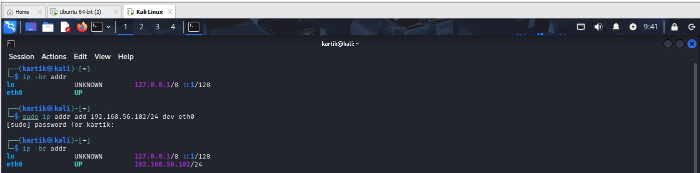
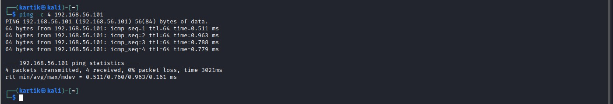
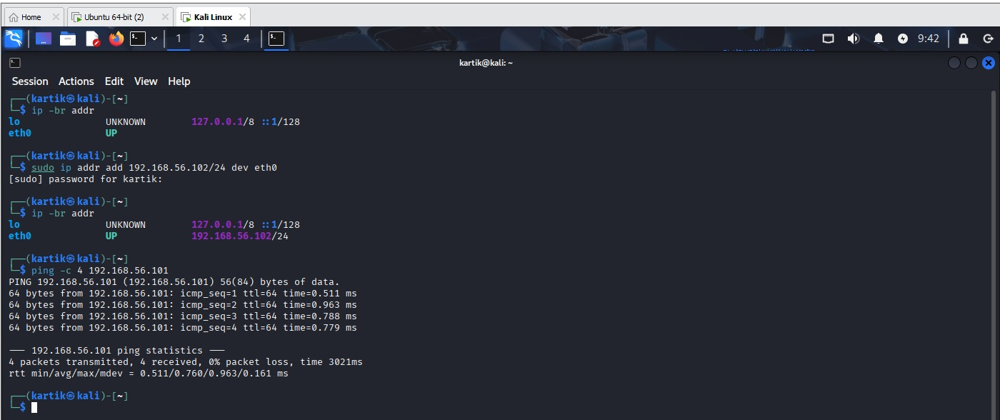
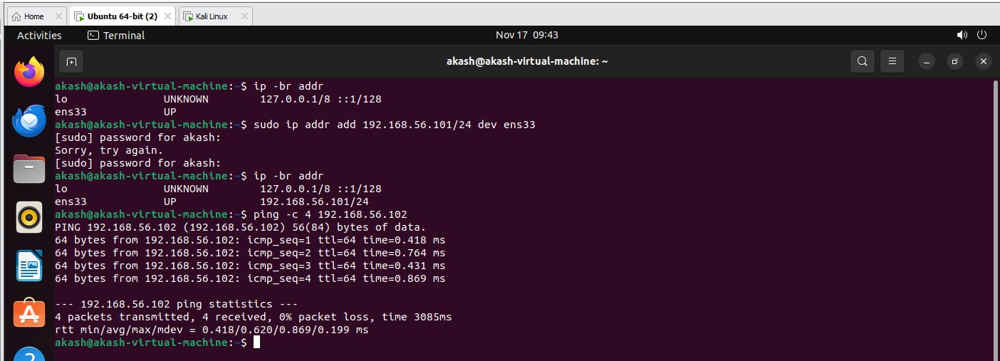

---

### Phase 2: iptables firewall (done)

**Goal:** block everything by default and explicitly allow only the traffic the lab needs.

| Chain | Meaning | Policy used |
|---|---|---|
| INPUT | Packets addressed to Ubuntu | DROP |
| FORWARD | Packets routed through Ubuntu | DROP |
| OUTPUT | Packets generated by Ubuntu | ACCEPT |

**Ubuntu**

```bash
# 1. Inspect the default rules and back them up
sudo iptables -L -n -v
sudo iptables-save | sudo tee ~/iptables-backup.rules > /dev/null

# 2. Allow required traffic
sudo iptables -A INPUT -i lo -j ACCEPT
sudo iptables -A INPUT -m conntrack --ctstate ESTABLISHED,RELATED -j ACCEPT
sudo iptables -A INPUT -p icmp --icmp-type echo-request -j ACCEPT
sudo iptables -A INPUT -p tcp --dport 22 -m conntrack --ctstate NEW -j ACCEPT
sudo iptables -A INPUT -p tcp --dport 80 -m conntrack --ctstate NEW -j ACCEPT

# 3. Rate-limited logging for anything that reaches the end of the chain
sudo iptables -A INPUT -m limit --limit 5/min --limit-burst 10 \
     -j LOG --log-prefix "IPTABLES-DROP: " --log-level 4

# 4. Default policies (apply AFTER the allow rules so you do not lock yourself out)
sudo iptables -P INPUT DROP
sudo iptables -P FORWARD DROP
sudo iptables -P OUTPUT ACCEPT

# 5. Verify
sudo iptables -L -n -v --line-numbers
```

Resulting INPUT chain:

| # | Target | Match |
|---|---|---|
| 1 | ACCEPT | loopback interface |
| 2 | ACCEPT | `ctstate RELATED,ESTABLISHED` |
| 3 | ACCEPT | ICMP echo-request (type 8) |
| 4 | ACCEPT | `tcp dpt:22 ctstate NEW` |
| 5 | ACCEPT | `tcp dpt:80 ctstate NEW` |
| 6 | LOG | rate-limited, prefix `IPTABLES-DROP: ` |
| - | policy DROP | everything else |

> **Common error:** `unknown option "--ctstate"` means the `-m conntrack` module was not named. Always write `-m conntrack --ctstate ...`.

> **Persistence:** iptables rules are lost on reboot. To keep them, install `iptables-persistent` and run `sudo netfilter-persistent save`.

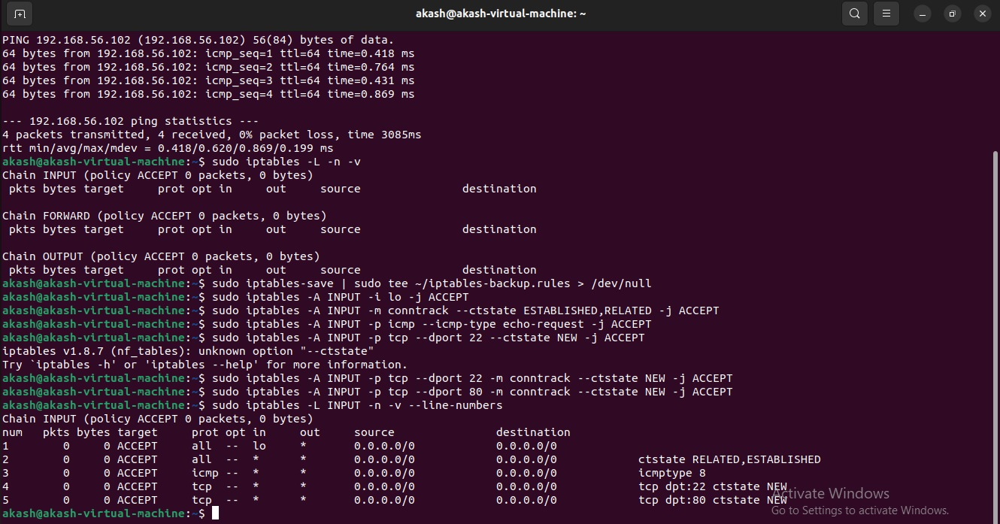
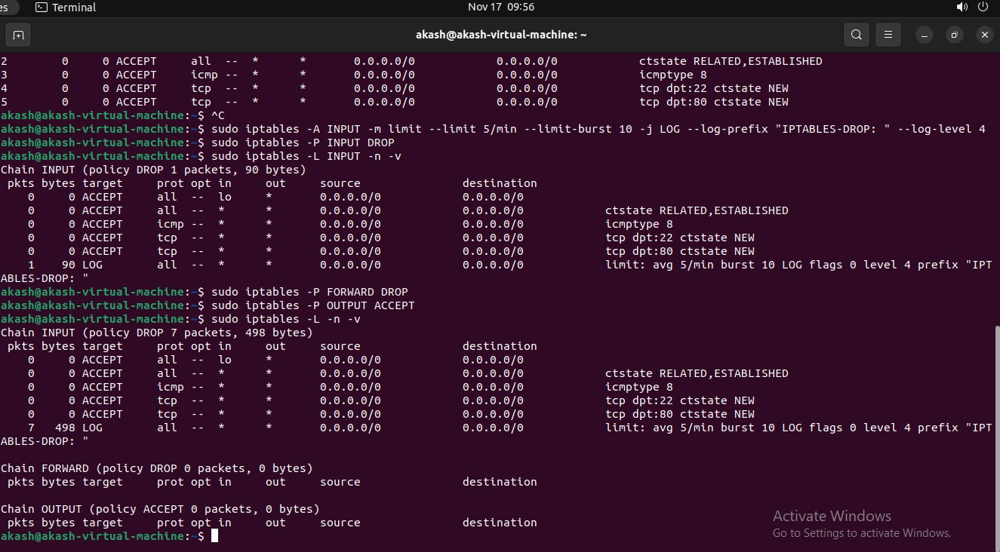

**Optional: explicit port-443 trace rules** (makes the blocked-port test produce its own counters and log prefix):

```bash
sudo iptables -I INPUT 1 -i ens33 -p tcp --dport 443 -j DROP
sudo iptables -I INPUT 1 -i ens33 -p tcp --dport 443 -m limit --limit 5/min \
     -j LOG --log-prefix "IPTABLES-DROP-443: " --log-level 4
```

The second command is inserted above the first, so the LOG rule runs before the DROP rule.

---

### Phase 3: Nginx web server (done)

**Goal:** run a public-facing web server on port 80 and prove that legitimate traffic is allowed while other ports stay blocked.

**Ubuntu** (the firewall allows outbound traffic, so package installation works)

```bash
sudo apt update
sudo apt install -y nginx
sudo systemctl enable --now nginx
sudo systemctl status nginx --no-pager
```

Expected result: `active (running)`.

**Test 1: legitimate HTTP request (Kali)**

```bash
curl -I http://192.168.56.101
```

Expected result: `HTTP/1.1 200 OK` with `Server: nginx/1.18.0 (Ubuntu)`. A security system must allow genuine requests too.

**Test 2: blocked port (Kali)**

```bash
nc -vz -w 5 192.168.56.101 443
```

Expected result: `Connection timed out`. Port 443 is not allowed, so the connection is never established. The timeout alone does not prove which device dropped it, so confirm on Ubuntu with the counters and logs below.

**Check the firewall evidence (Ubuntu)**

```bash
sudo iptables -L INPUT -n -v -x --line-numbers
sudo journalctl -k | grep "IPTABLES-DROP" | tail -n 10
```

Compare the counters with the earlier snapshot. The port-80 ACCEPT rule and the LOG rule counters should have increased, and the policy DROP counter should show the dropped packets.

> The `IPTABLES-DROP` entries you may see for destination `224.0.0.251`, port `5353`, are multicast DNS (mDNS) packets caught by the default-DROP policy. They are background traffic, not the port-443 test.

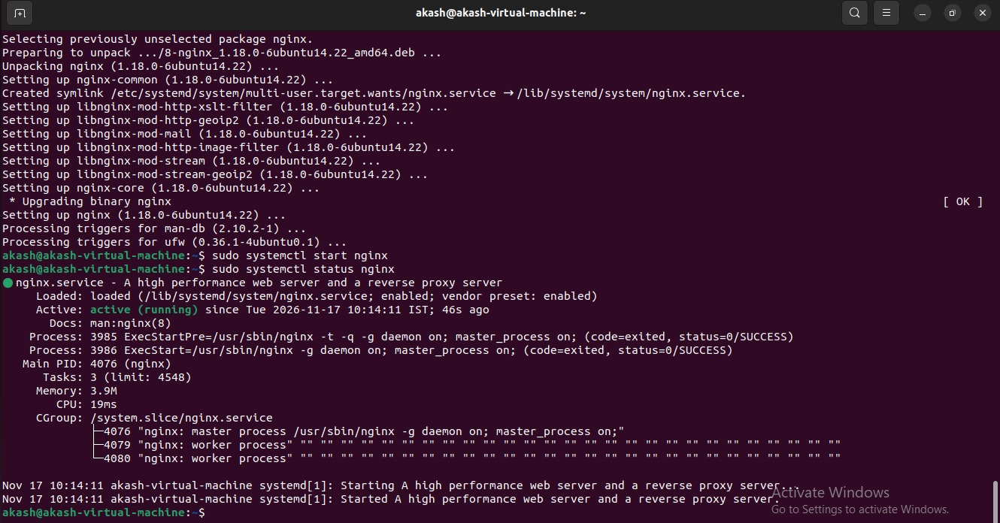
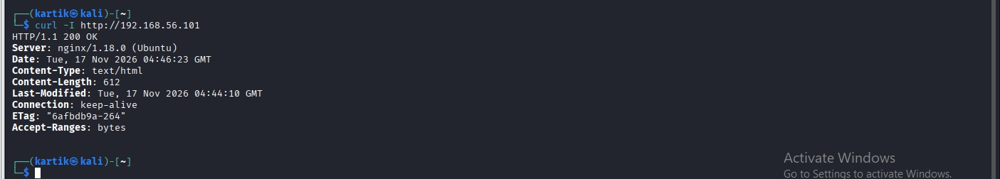
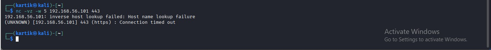
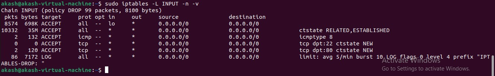
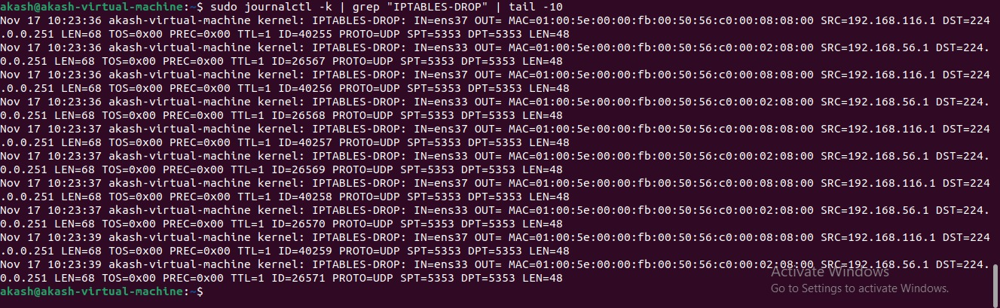

---

### Phase 4: Snort installation and validation (done)

**Goal:** install Snort and confirm its configuration loads without errors before generating any test traffic.

**Ubuntu**

```bash
sudo apt install -y snort
snort --version
sudo snort -T -c /etc/snort/snort.conf -i ens33
```

Expected result at the end of the output:

```
Snort successfully validated the configuration!
Snort exiting
```

This means Snort could read its configuration and rules without a configuration error. Snort here is version 2.9.15.1. The warnings about unused flowbits keys are normal.

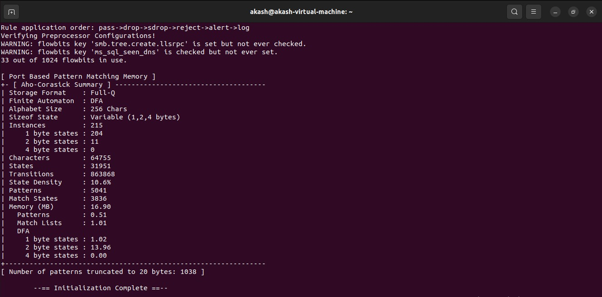
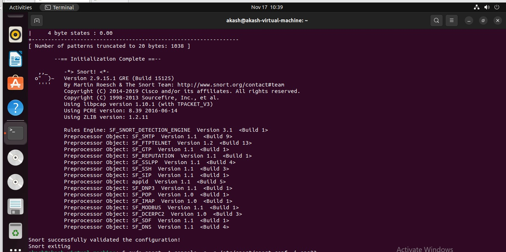

---

### Phase 5: Snort IDS rules and alerts (pending)

**Goal:** write custom rules and show that Snort **detects** matching traffic and raises alerts. In this experiment Snort runs passively, so an alert means "the traffic matched a rule", not "the traffic was blocked".

**Step 5.1: Set `HOME_NET` (Ubuntu)**

Edit `/etc/snort/snort.conf` and set:

```
ipvar HOME_NET 192.168.56.0/24
```

Make sure the local rules file is included:

```
include $RULE_PATH/local.rules
```

**Step 5.2: Create the custom rules (Ubuntu)**

```bash
sudo tee /etc/snort/rules/local.rules > /dev/null <<'EOF'
# Defense-in-Depth Network Security Project
# Custom Snort 2.9 rules
alert icmp any any -> $HOME_NET any (msg:"LAB ICMP Echo Request Detected"; itype:8; sid:1000001; rev:1;)
drop tcp any any -> $HOME_NET 80 (msg:"LAB Possible SQL Injection Pattern"; content:"1%27%20OR%201=1"; nocase; sid:1000002; rev:1;)
alert tcp any any -> $HOME_NET any (msg:"LAB TCP SYN Activity Detected"; flags:S; sid:1000003; rev:1;)
EOF
sudo cat /etc/snort/rules/local.rules
```

| SID | Action | Protocol / port | Detects |
|---|---|---|---|
| 1000001 | alert | ICMP | Echo request (ping) |
| 1000002 | drop | TCP to port 80 | A predefined SQL-injection-like string in an HTTP request (`1' OR 1=1`, URL-encoded) |
| 1000003 | alert | TCP | SYN flag set (start of a TCP connection) |

Each rule defines the traffic conditions to match and the action to take. SIDs from 1000000 upward are reserved for local rules. In passive IDS mode a `drop` rule only alerts, because nothing is sitting in the packet path. It becomes a real drop in Phase 7.

**Step 5.3: Validate again (Ubuntu)**

```bash
sudo snort -T -c /etc/snort/snort.conf -i ens33
```

Validate before generating any test traffic. Expect `Snort successfully validated the configuration!`.

**Step 5.4: Make sure only one Snort is running (Ubuntu)**

```bash
pgrep -af snort
sudo systemctl stop snort 2>/dev/null
```

**Step 5.5: Start Snort in alert mode (Ubuntu, leave this terminal open)**

```bash
sudo snort -A console -q -c /etc/snort/snort.conf -i ens33
```

**Step 5.6: Generate ICMP traffic (Kali)**

```bash
ping -c 5 192.168.56.101
```

Expected Snort output (Ubuntu terminal):

```
[**] [1:1000001:1] LAB ICMP Echo Request Detected [**] [Priority: 0] {ICMP} 192.168.56.102 -> 192.168.56.101
```

Five alerts, one per echo request. The ping itself still succeeds because Snort is not blocking.

**Step 5.7: Generate TCP SYN traffic (Kali)**

```bash
for i in 1 2 3; do nc -z -w 2 192.168.56.101 443; done
```

Expected Snort output:

```
[**] [1:1000003:1] LAB TCP SYN Activity Detected [**] [Priority: 0] {TCP} 192.168.56.102:<port> -> 192.168.56.101:443
```

Snort captures packets from the interface before iptables filters them, so you see the SYN alerts even though the firewall then drops the connection to port 443. A SYN alert alone does not prove a port scan, and it does not prove the connection was blocked.

**Screenshots to capture**

| Name | What it shows |
|---|---|
| `14_ubuntu_snort_custom_rules.png` | `cat /etc/snort/rules/local.rules` |
| `15_ubuntu_snort_ids_running.png` | Validation message and the Snort console started with `pgrep -af snort` |
| `16_kali_icmp_traffic_generation.png` | `ping -c 5` from Kali |
| `17_ubuntu_snort_icmp_alerts.png` | SID 1000001 alerts |
| `18_kali_tcp_syn_traffic_generation.png` | The `nc` loop from Kali |
| `19_ubuntu_snort_tcp_syn_alerts.png` | SID 1000003 alerts |

---

### Phase 6: Flask application and Nginx reverse proxy (pending)

**Goal:** add the application layer. Nginx is the only public entry point on port 80 and forwards requests internally to Flask on `127.0.0.1:5000`. This phase comes before the inline IPS test so that a normal request to `/public` returns `200 OK` first, which makes the later "request never reached the application" result meaningful.

**Step 6.1: Create the project folder and virtual environment (Ubuntu)**

```bash
mkdir -p ~/network-security-project && cd ~/network-security-project
sudo apt install -y python3-venv python3-pip
python3 -m venv venv
source venv/bin/activate
pip install flask pyjwt python-dotenv
```

**Step 6.2: Generate the secrets and create `.env` (Ubuntu)**

```bash
cat > .env <<EOF
JWT_SECRET=$(openssl rand -hex 32)
JWT_TTL_SECONDS=900
ADMIN_USER=admin
ADMIN_PASSWORD=$(openssl rand -base64 12)
OAUTH_CLIENT_ID=$(python3 -c "import secrets; print(secrets.token_urlsafe(16))")
OAUTH_CLIENT_SECRET=$(python3 -c "import secrets; print(secrets.token_urlsafe(32))")
OAUTH_REDIRECT_URI=http://192.168.56.101/callback
EOF
chmod 600 .env
```

Never commit `.env`. See [Security notes](#9-security-notes-for-this-repository).

**Step 6.3: Create the application (`app.py`)**

```python
"""Defense-in-Depth demo application: Flask + JWT + OAuth 2.0 Authorization Code."""
import os
import secrets
import time
from datetime import datetime, timezone
from functools import wraps
from urllib.parse import urlencode

import jwt
from dotenv import load_dotenv
from flask import Flask, g, jsonify, redirect, request
from werkzeug.security import check_password_hash, generate_password_hash

load_dotenv()
app = Flask(__name__)

# ---------- Configuration (from .env) ----------
JWT_SECRET = os.environ["JWT_SECRET"]
JWT_ALG = "HS256"
JWT_TTL = int(os.getenv("JWT_TTL_SECONDS", "900"))

USERS = {
    os.environ.get("ADMIN_USER", "admin"): {
        "password_hash": generate_password_hash(os.environ["ADMIN_PASSWORD"]),
        "role": "admin",
    }
}

OAUTH_CLIENT_ID = os.environ["OAUTH_CLIENT_ID"]
OAUTH_CLIENT_SECRET = os.environ["OAUTH_CLIENT_SECRET"]
OAUTH_REDIRECT_URI = os.environ["OAUTH_REDIRECT_URI"]
CODE_TTL = 120      # authorization code lifetime (seconds)
TOKEN_TTL = 900     # access token lifetime (seconds)
AUTH_CODES = {}     # code -> {client_id, redirect_uri, user, exp}
ACCESS_TOKENS = {}  # token -> {user, exp}


def error(message, status):
    return jsonify({"status": "error", "message": message}), status


# ---------- JWT protection ----------
def jwt_required(fn):
    @wraps(fn)
    def wrapper(*args, **kwargs):
        header = request.headers.get("Authorization")
        if not header:
            return error("Authorization header missing", 401)
        if not header.startswith("Bearer "):
            return error("Invalid authorization scheme", 401)
        try:
            g.claims = jwt.decode(header[7:], JWT_SECRET, algorithms=[JWT_ALG])
        except jwt.ExpiredSignatureError:
            return error("Token expired", 401)
        except jwt.InvalidTokenError:
            return error("Invalid token", 401)
        return fn(*args, **kwargs)
    return wrapper


# ---------- Public and JWT-protected routes ----------
@app.get("/public")
def public():
    return jsonify(
        message="Public endpoint accessible without authentication",
        status="success",
        timestamp=datetime.now(timezone.utc).isoformat(),
    )


@app.post("/login")
def login():
    data = request.get_json(silent=True) or {}
    user = USERS.get(data.get("username", ""))
    if not user or not check_password_hash(user["password_hash"], data.get("password", "")):
        return error("Invalid credentials", 401)
    now = int(time.time())
    token = jwt.encode(
        {"sub": data["username"], "role": user["role"], "iat": now, "exp": now + JWT_TTL},
        JWT_SECRET,
        algorithm=JWT_ALG,
    )
    return jsonify(access_token=token, token_type="Bearer", expires_in=JWT_TTL)


@app.get("/protected")
@jwt_required
def protected():
    if g.claims.get("role") != "admin":
        return error("Forbidden", 403)
    return jsonify(
        status="success",
        message="Welcome admin! You have accessed the JWT-protected endpoint.",
        user=g.claims["sub"],
        claims=g.claims,
    )


# ---------- OAuth 2.0 Authorization Code flow ----------
@app.get("/oauth/authorize")
def oauth_authorize():
    if request.args.get("response_type") != "code":
        return error("unsupported_response_type", 400)
    if request.args.get("client_id") != OAUTH_CLIENT_ID:
        return error("invalid_client", 400)
    redirect_uri = request.args.get("redirect_uri", "")
    if redirect_uri != OAUTH_REDIRECT_URI:          # exact match only
        return error("invalid_redirect_uri", 400)

    # Lab simplification: the resource owner "admin" approves automatically.
    code = secrets.token_urlsafe(24)
    AUTH_CODES[code] = {
        "client_id": OAUTH_CLIENT_ID,
        "redirect_uri": redirect_uri,
        "user": "admin",
        "exp": time.time() + CODE_TTL,
    }
    params = {"code": code}
    if request.args.get("state"):
        params["state"] = request.args["state"]
    return redirect(f"{redirect_uri}?{urlencode(params)}", code=302)


@app.post("/oauth/token")
def oauth_token():
    f = request.form
    if f.get("grant_type") != "authorization_code":
        return error("unsupported_grant_type", 400)
    if f.get("client_id") != OAUTH_CLIENT_ID or not secrets.compare_digest(
        f.get("client_secret", ""), OAUTH_CLIENT_SECRET
    ):
        return error("invalid_client", 401)

    entry = AUTH_CODES.pop(f.get("code", ""), None)  # single use
    if not entry or entry["exp"] < time.time():
        return error("invalid_grant", 400)
    if entry["redirect_uri"] != f.get("redirect_uri"):
        return error("invalid_grant", 400)

    token = secrets.token_urlsafe(32)
    ACCESS_TOKENS[token] = {"user": entry["user"], "exp": time.time() + TOKEN_TTL}
    return jsonify(access_token=token, token_type="Bearer", expires_in=TOKEN_TTL)


@app.get("/oauth/protected")
def oauth_protected():
    header = request.headers.get("Authorization", "")
    entry = ACCESS_TOKENS.get(header[7:]) if header.startswith("Bearer ") else None
    if not entry or entry["exp"] < time.time():
        return error("invalid_token", 401)
    return jsonify(status="success", message="OAuth protected resource", user=entry["user"])


if __name__ == "__main__":
    # Bound to localhost only: Nginx is the only public entry point.
    app.run(host="127.0.0.1", port=5000)
```

**Step 6.4: Run Flask (Ubuntu, in a second terminal)**

```bash
cd ~/network-security-project && source venv/bin/activate
python app.py
```

Verify it listens on localhost only:

```bash
sudo ss -lntp | grep ':5000'
```

Expected: `LISTEN ... 127.0.0.1:5000 ... python`. Flask must not be reachable from Kali directly.

**Step 6.5: Configure Nginx as a reverse proxy (Ubuntu)**

```bash
sudo tee /etc/nginx/sites-available/flask_proxy > /dev/null <<'EOF'
server {
    listen 80 default_server;
    server_name _;

    location / {
        proxy_pass http://127.0.0.1:5000;
        proxy_set_header Host $host;
        proxy_set_header X-Real-IP $remote_addr;
        proxy_set_header X-Forwarded-For $proxy_add_x_forwarded_for;
        proxy_set_header X-Forwarded-Proto $scheme;
    }
}
EOF
sudo rm -f /etc/nginx/sites-enabled/default
sudo ln -sf /etc/nginx/sites-available/flask_proxy /etc/nginx/sites-enabled/flask_proxy
sudo nginx -t
sudo systemctl reload nginx
sudo ss -lntp | grep ':80'
```

Expected: `syntax is ok`, `test is successful`, and Nginx listening on `0.0.0.0:80`.

**Step 6.6: Test the public endpoint (Kali)**

```bash
curl -i --max-time 5 http://192.168.56.101/public
```

Expected: `HTTP/1.1 200 OK`, `Content-Type: application/json`, and a JSON body with `"status":"success"`.

**Step 6.7: Confirm the firewall counter moved (Ubuntu)**

```bash
sudo iptables -L INPUT -n -v -x --line-numbers
```

The `tcp dpt:80 ctstate NEW` counter should be higher than before the request.

**Screenshots to capture**

| Name | What it shows |
|---|---|
| `20_ubuntu_flask_listening_localhost_5000.png` | `ss -lntp` showing Flask on `127.0.0.1:5000` |
| `21_ubuntu_nginx_reverse_proxy_config_test.png` | `nginx -t`, service status and port 80 listener |
| `22_kali_public_endpoint_via_nginx_200_json.png` | `curl -i /public` returning 200 and JSON |

---

### Phase 7: Snort inline IPS (NFQUEUE) (pending)

**Goal:** a separate experiment where Snort sits **in the packet path** and drops a matching request before it reaches Nginx or Flask.

NFQUEUE is a packet queue: Netfilter hands selected packets to a user-space program (Snort), which inspects each one and returns a verdict (accept or drop).

**Step 7.1: Stop the passive Snort and check the DAQ module (Ubuntu)**

```bash
pgrep -af snort
sudo pkill snort 2>/dev/null
snort --daq-list
```

The list must include `nfq`. If it does not, install the NFQ-enabled Snort and DAQ packages for your distribution.

**Step 7.2: Record the BEFORE counters (Ubuntu)**

```bash
sudo iptables -L INPUT -n -v -x --line-numbers
```

**Step 7.3: Send HTTP port-80 traffic to the queue (Ubuntu)**

```bash
sudo iptables -I INPUT 1 -i ens33 -p tcp --dport 80 -j NFQUEUE --queue-num 1 --queue-bypass
sudo iptables -L INPUT -n -v --line-numbers
```

The rule is inserted at position 1, **above** the `ESTABLISHED,RELATED` accept rule. This matters: the malicious request travels in a packet that belongs to an already-established connection, so if the established rule came first the packet would never reach the queue. `--queue-bypass` accepts packets if Snort is not running, so a stopped Snort cannot silently cut off the web server.

**Step 7.4: Start Snort in inline mode (Ubuntu, leave this terminal open)**

```bash
sudo snort -Q --daq nfq --daq-var queue=1 -A console -q -c /etc/snort/snort.conf
```

**Step 7.5: Baseline check (Kali)** - a normal request must still work.

```bash
curl -i --max-time 5 http://192.168.56.101/public
```

Expected: `HTTP/1.1 200 OK`. Legitimate traffic passes through the IPS untouched.

**Step 7.6: Send the SQL-injection-like test request (Kali)**

This is a predefined test string used only to trigger the custom rule inside the isolated lab.

```bash
curl -i --max-time 5 "http://192.168.56.101/public?id=1%27%20OR%201=1"
```

Expected on Kali: no HTTP response (the request times out or the connection is reset).

Expected on Ubuntu (Snort console): an alert for `[1:1000002:1] LAB Possible SQL Injection Pattern` with action drop.

**Step 7.7: Collect the AFTER evidence (Ubuntu)**

```bash
# Firewall counters: the NFQUEUE rule should show more packets than before
sudo iptables -L INPUT -n -v -x --line-numbers

# Nginx should have NO entry for the malicious request
sudo grep "1%27" /var/log/nginx/access.log || echo "0 entries: request never reached Nginx"

# Flask terminal should also show no log line for that request
```

Counter delta = AFTER packets minus BEFORE packets. A higher count on the NFQUEUE rule proves the packets were sent to Snort. If Snort records DROP and the request does not appear in the Nginx access log, the request was stopped before reaching the web application.

**Step 7.8: Clean up after the experiment (Ubuntu)**

Press `Ctrl+C` in the Snort terminal, then remove the queue rule so normal operation resumes:

```bash
sudo iptables -D INPUT -i ens33 -p tcp --dport 80 -j NFQUEUE --queue-num 1 --queue-bypass
```

**Screenshots to capture**

| Name | What it shows |
|---|---|
| `23_ubuntu_nfqueue_rule_and_snort_inline_started.png` | NFQUEUE rule in iptables and Snort started in inline mode |
| `24_kali_sqli_like_request_sent.png` | The test request from Kali (timeout or reset) |
| `25_ubuntu_snort_inline_drop_alert.png` | SID 1000002 drop alert in the Snort console |
| `26_ubuntu_nginx_flask_not_reached_and_counter_delta.png` | BEFORE/AFTER counters and 0 matching Nginx log entries |

---

### Phase 8: JWT authentication (pending)

**Goal:** show that reaching the application is not enough. Protected endpoints require a valid, signed JWT.

A JWT has three parts, `header.payload.signature`. The server signs the header and payload with the secret key and must **verify the signature** on every request, rather than trusting the token text.

Make sure Flask is running and Nginx is proxying (Phase 6), and that the Snort inline rule from Phase 7 has been removed or Snort is running normally.

**On Kali, set the credentials as shell variables** (copy the values from the Ubuntu `.env`; do not save them in any file in the repository):

```bash
export ADMIN_PASSWORD='<value from .env>'
```

**Test 1: no token (Kali)**

```bash
curl -i --max-time 5 http://192.168.56.101/protected
```

Expected: `HTTP/1.1 401 UNAUTHORIZED` with `{"message":"Authorization header missing","status":"error"}`. The network layer allowed the request to reach the application, but the application denied it because authentication was missing.

**Test 2: login and valid token (Kali)**

```bash
TOKEN=$(curl -s -X POST http://192.168.56.101/login \
  -H "Content-Type: application/json" \
  -d "{\"username\":\"admin\",\"password\":\"$ADMIN_PASSWORD\"}" \
  | python3 -c "import sys,json; print(json.load(sys.stdin)['access_token'])")

echo "${TOKEN:0:20}...[REDACTED]"

curl -i --max-time 5 -H "Authorization: Bearer $TOKEN" http://192.168.56.101/protected
```

Expected: `HTTP/1.1 200 OK` and a JSON body such as `"Welcome admin! You have accessed the JWT-protected endpoint."` with claims `sub=admin`, `role=admin`, `iat`, `exp`. Redact the token before taking the screenshot.

**Test 3: tampered token (Kali)**

```bash
TAMPERED="${TOKEN:0:${#TOKEN}-5}AAAAA"

curl -i --max-time 5 -H "Authorization: Bearer $TAMPERED" http://192.168.56.101/protected
```

Expected: `HTTP/1.1 401 UNAUTHORIZED` with `{"message":"Invalid token","status":"error"}`. The signature check fails, which is why the server must verify the signature rather than trust token text.

**Check counters (Ubuntu)**

```bash
sudo iptables -L INPUT -n -v -x --line-numbers
```

The port-80 ACCEPT counter increases with each request, which shows the firewall allowed all three. The rejections happened in the application layer.

**Screenshots to capture**

| Name | What it shows |
|---|---|
| `27_kali_jwt_missing_token_401.png` | Request without a token returns 401 |
| `28_kali_jwt_login_valid_token_200.png` | Login, redacted token, protected endpoint returns 200 |
| `29_kali_jwt_tampered_token_401.png` | Modified token returns 401 |

---

### Phase 9: OAuth 2.0 Authorization Code flow (pending)

**Goal:** show how a client obtains permission to access a protected resource. At a high level:

```
 Client (Kali)                          Flask (authorization + resource server)
      |  1. GET /oauth/authorize            |
      |------------------------------------>|   validates client_id + redirect_uri
      |  2. 302 redirect with ?code=...     |
      |<------------------------------------|
      |  3. POST /oauth/token (code+secret) |
      |------------------------------------>|   single-use code exchanged
      |  4. access_token                    |
      |<------------------------------------|
      |  5. GET /oauth/protected (Bearer)   |
      |------------------------------------>|
      |  6. 200 OK + resource               |
      |<------------------------------------|
```

OAuth demonstrates authorization; JWT is used separately in this project for token validation.

**Set the values on Kali** (copy from the Ubuntu `.env`):

```bash
export CLIENT_ID='<OAUTH_CLIENT_ID from .env>'
export CLIENT_SECRET='<OAUTH_CLIENT_SECRET from .env>'
export REDIRECT_URI='http://192.168.56.101/callback'
```

**Step 1: authorization request (Kali)**

```bash
curl -si -G http://192.168.56.101/oauth/authorize \
  --data-urlencode "response_type=code" \
  --data-urlencode "client_id=$CLIENT_ID" \
  --data-urlencode "redirect_uri=$REDIRECT_URI" \
  --data-urlencode "state=xyz123"
```

Expected: `HTTP/1.1 302 FOUND` and a `Location:` header containing `?code=...&state=xyz123`.

Capture the code:

```bash
CODE=$(curl -si -G http://192.168.56.101/oauth/authorize \
  --data-urlencode "response_type=code" \
  --data-urlencode "client_id=$CLIENT_ID" \
  --data-urlencode "redirect_uri=$REDIRECT_URI" \
  --data-urlencode "state=xyz123" \
  | grep -i '^location' | sed -n 's/.*code=\([^&[:space:]]*\).*/\1/p')
echo "code: ${CODE:0:8}...[REDACTED]"
```

**Step 2: token exchange (Kali)**

```bash
ACCESS=$(curl -s -X POST http://192.168.56.101/oauth/token \
  -d "grant_type=authorization_code" \
  -d "code=$CODE" \
  --data-urlencode "redirect_uri=$REDIRECT_URI" \
  -d "client_id=$CLIENT_ID" \
  -d "client_secret=$CLIENT_SECRET" \
  | python3 -c "import sys,json; print(json.load(sys.stdin)['access_token'])")
echo "token: ${ACCESS:0:8}...[REDACTED]"
```

**Step 3: access the protected resource (Kali)**

```bash
curl -i --max-time 5 -H "Authorization: Bearer $ACCESS" http://192.168.56.101/oauth/protected
```

Expected: `HTTP/1.1 200 OK`.

**Step 4: bad redirect URI (Kali)**

```bash
curl -i -G http://192.168.56.101/oauth/authorize \
  --data-urlencode "response_type=code" \
  --data-urlencode "client_id=$CLIENT_ID" \
  --data-urlencode "redirect_uri=http://attacker.example/callback" \
  --data-urlencode "state=xyz123"
```

Expected: `HTTP/1.1 400 BAD REQUEST` with `invalid_redirect_uri`. Exact-match redirect URI checking stops an attacker from receiving the authorization code.

**Optional: code reuse (Kali)** - run the Step 2 token request a second time with the same `$CODE`. Expected: `400 invalid_grant`, because authorization codes are single-use.

**Screenshots to capture**

| Name | What it shows |
|---|---|
| `30_kali_oauth_authorize_code_redirect.png` | 302 response with redacted `code` in `Location` |
| `31_kali_oauth_token_exchange_and_protected_200.png` | Token exchange and protected resource returns 200 |
| `32_kali_oauth_bad_redirect_400.png` | Invalid redirect URI returns 400 |

---

### Phase 10: Final verification (pending)

Collect one summary of the whole experiment.

**Ubuntu**

```bash
sudo iptables -L INPUT -n -v -x --line-numbers
sudo journalctl -k | grep "IPTABLES-DROP" | tail -n 10
sudo tail -n 20 /var/log/nginx/access.log
```

| # | Test | Source | Expected result | Layer that acted |
|---|---|---|---|---|
| 1 | Ping | Kali | Replies, 0% loss | iptables ICMP rule |
| 2 | `curl /public` | Kali | 200 OK | iptables + Nginx + Flask |
| 3 | TCP port 443 | Kali | Connection timed out | iptables default DROP |
| 4 | Ping with Snort IDS | Kali | Ping works, ICMP alert raised | Snort IDS |
| 5 | TCP SYN to 443 | Kali | SYN alerts raised, connection fails | Snort IDS + iptables |
| 6 | SQLi-like request, inline IPS | Kali | No response; 0 entries in Nginx log | Snort inline IPS |
| 7 | `/protected`, no token | Kali | 401 | Flask JWT |
| 8 | `/protected`, valid token | Kali | 200 | Flask JWT |
| 9 | `/protected`, tampered token | Kali | 401 | Flask JWT |
| 10 | OAuth authorize, token, resource | Kali | 302, 200, 200 | Flask OAuth |
| 11 | OAuth bad redirect URI | Kali | 400 | Flask OAuth |

**Screenshot to capture:** `33_ubuntu_final_iptables_counters_summary.png`.

---

## 7. How to read the evidence

- **iptables counters:** `pkts` is the number of packets matched by a rule and `bytes` is the total size. If a counter rises after a test, that traffic matched that rule. Always read counters together with the logs and the client's response.
- **Firewall logs:** these are kernel log entries from the LOG rule. Read the timestamp, source and destination addresses, protocol and port. Logging only records matching traffic; the DROP rule or policy is what blocks it.
- **Timeouts:** a timeout on Kali does not prove which device dropped the traffic. Confirm with the Ubuntu-side counters or logs.
- **Snort alerts (IDS):** an alert means traffic matched a rule. It does not mean the traffic was blocked.
- **Snort drops (inline IPS):** a drop verdict plus zero entries in the Nginx access log supports the conclusion that the request never reached the web application.
- **HTTP status codes:** `200` success, `302` redirect, `400` bad request, `401` authentication missing or invalid, `403` authenticated but not permitted.

---

## 8. Screenshot index

| File | Phase | Status |
|---|---|---|
| `01_kali_assign_ip_192-168-56-102.jpeg` | 1 | Captured |
| `02_kali_ping_ubuntu_connectivity.jpeg` | 1 | Captured |
| `03_kali_ip_setup_and_ping_full_view.jpeg` | 1 | Captured |
| `04_ubuntu_assign_ip_and_ping_kali.jpeg` | 1 | Captured |
| `05_ubuntu_iptables_backup_and_allow_rules.jpeg` | 2 | Captured |
| `06_ubuntu_iptables_log_rule_and_default_drop.jpeg` | 2 | Captured |
| `07_ubuntu_nginx_install_and_status.jpeg` | 3 | Captured |
| `08_kali_http_request_to_nginx_200_ok.jpeg` | 3 | Captured |
| `09_kali_blocked_port_443_timeout.jpeg` | 3 | Captured |
| `10_ubuntu_iptables_counters_after_tests.jpeg` | 3 | Captured |
| `11_ubuntu_firewall_drop_logs.jpeg` | 3 | Captured |
| `12_ubuntu_snort_initialization.jpeg` | 4 | Captured |
| `13_ubuntu_snort_config_validated.jpeg` | 4 | Captured |
| `14_ubuntu_snort_custom_rules` | 5 | Pending |
| `15_ubuntu_snort_ids_running` | 5 | Pending |
| `16_kali_icmp_traffic_generation` | 5 | Pending |
| `17_ubuntu_snort_icmp_alerts` | 5 | Pending |
| `18_kali_tcp_syn_traffic_generation` | 5 | Pending |
| `19_ubuntu_snort_tcp_syn_alerts` | 5 | Pending |
| `20_ubuntu_flask_listening_localhost_5000` | 6 | Pending |
| `21_ubuntu_nginx_reverse_proxy_config_test` | 6 | Pending |
| `22_kali_public_endpoint_via_nginx_200_json` | 6 | Pending |
| `23_ubuntu_nfqueue_rule_and_snort_inline_started` | 7 | Pending |
| `24_kali_sqli_like_request_sent` | 7 | Pending |
| `25_ubuntu_snort_inline_drop_alert` | 7 | Pending |
| `26_ubuntu_nginx_flask_not_reached_and_counter_delta` | 7 | Pending |
| `27_kali_jwt_missing_token_401` | 8 | Pending |
| `28_kali_jwt_login_valid_token_200` | 8 | Pending |
| `29_kali_jwt_tampered_token_401` | 8 | Pending |
| `30_kali_oauth_authorize_code_redirect` | 9 | Pending |
| `31_kali_oauth_token_exchange_and_protected_200` | 9 | Pending |
| `32_kali_oauth_bad_redirect_400` | 9 | Pending |
| `33_ubuntu_final_iptables_counters_summary` | 10 | Pending |

---

## 9. Security notes for this repository

- **Never commit secrets.** The JWT secret, admin password, OAuth client secret and real tokens belong in `.env`, which is listed in `.gitignore`. Commit `.env.example` with placeholders only.
- **Redact tokens in screenshots.** Show only the first few characters, for example `eyJhbGci...[REDACTED]`.
- **Hostnames and usernames** (for example in terminal prompts) appear in screenshots. Decide whether you are comfortable publishing them, and crop or blur if not.
- **Lab simplifications that must not be copied into production:** in-memory token storage, automatic approval of the authorization request, plain HTTP instead of HTTPS, and a single hard-coded user.
- **Use only on your own lab.** The SQL-injection-like string and the port tests are controlled inputs for an isolated network.

---

## 10. Troubleshooting

| Problem | Likely cause and fix |
|---|---|
| `unknown option "--ctstate"` | Add `-m conntrack` before `--ctstate`. |
| Locked out of SSH after setting policy DROP | Set `-P INPUT DROP` only after the port-22 allow rule exists. From the VM console run `sudo iptables -P INPUT ACCEPT`. |
| Kali cannot ping Ubuntu after a reboot | `ip addr add` is not persistent. Run it again or configure a static IP. |
| Snort validation fails on `local.rules` | Check `HOME_NET`, the `include $RULE_PATH/local.rules` line and rule syntax (each rule on one line, ending with `;)`). |
| Snort shows no alerts | Wrong interface. Use the host-only interface (`-i ens33`) and confirm no other Snort is running with `pgrep -af snort`. |
| Web server unreachable while inline Snort is stopped | The NFQUEUE rule has no listener. Add `--queue-bypass` or delete the rule. |
| Inline drop never triggers | The NFQUEUE rule must sit **above** the `ESTABLISHED,RELATED` rule (insert at position 1), and the DAQ list must include `nfq`. |
| Nginx returns `502 Bad Gateway` | Flask is not running on `127.0.0.1:5000`. Start `python app.py`. |
| `KeyError` for an environment variable when starting Flask | `.env` is missing a value. Re-create it using Step 6.2. |
| Token variable is empty on Kali | Login failed. Check `ADMIN_PASSWORD` and test the login `curl` without the pipe to see the error. |
| Nothing appears in `journalctl -k` | Rate limit on the LOG rule (5 per minute). Wait, then repeat the test. |

---

## 11. Conclusion

This project demonstrates Defense in Depth by combining different security mechanisms:

- **iptables** filters network traffic with a default-deny policy and logs what it drops.
- **Snort IDS** detects selected traffic patterns and generates alerts.
- In a separate **NFQUEUE inline experiment**, Snort can drop a matching request before it reaches the web application.
- **Nginx** receives web requests and forwards them to Flask.
- **Flask** checks JWT authentication for protected endpoints, and the **OAuth 2.0** demonstration shows an authorization flow to obtain access to a protected resource.

Both allowed and rejected requests are tested, and the results are verified using counters, logs, alerts and HTTP responses.

---

## Repository structure

```
defense-in-depth-web-app/
├── README.md
├── .gitignore
├── .env.example
├── screenshots/
│   ├── 01_kali_assign_ip_192-168-56-102.jpeg
│   ├── ...
│   └── 13_ubuntu_snort_config_validated.jpeg
└── app/                  (add when you complete Phase 6)
    └── app.py
```
